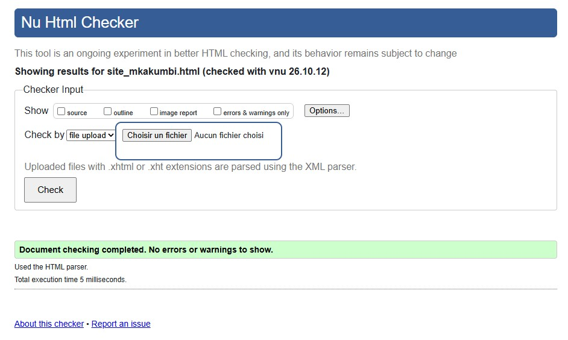
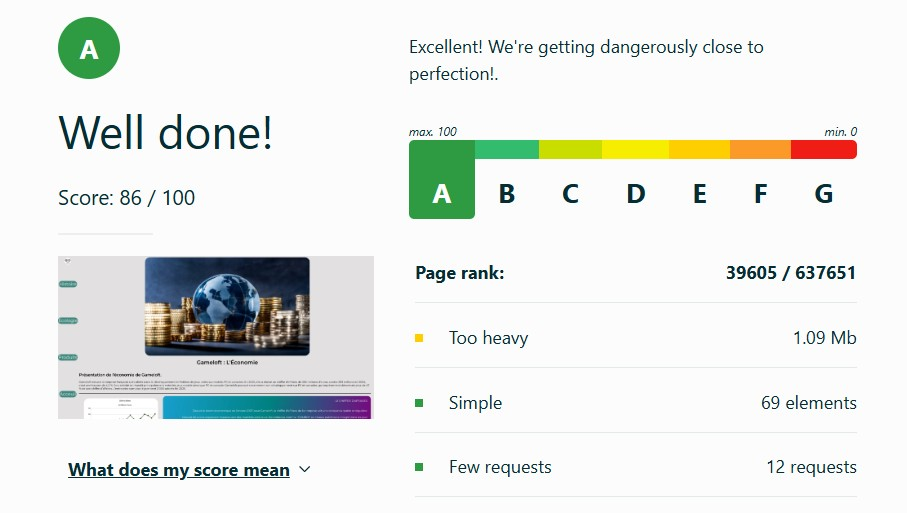
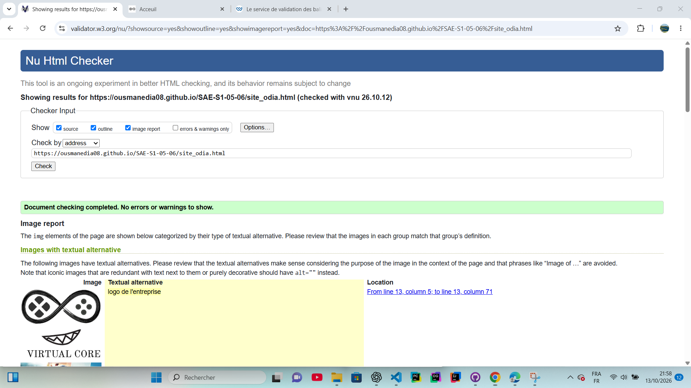
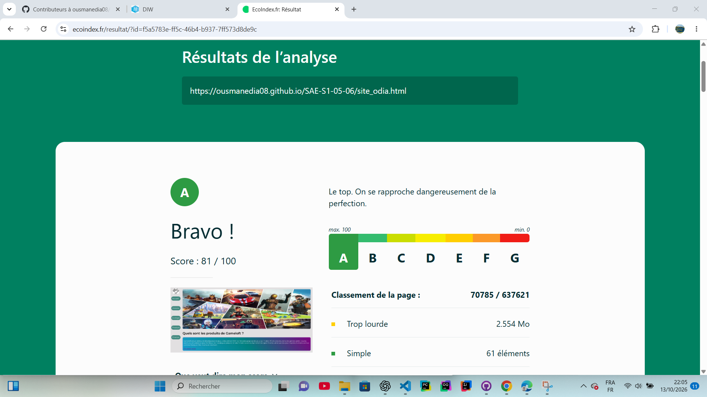
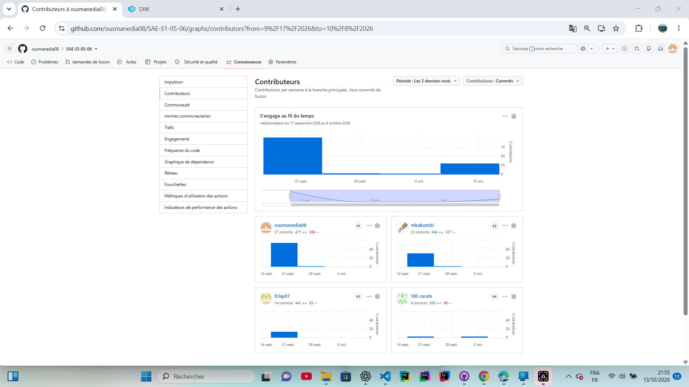

# Site SAÉ Gameloft

## Création d'un site présentant Gameloft.  

[SAE-S1-05-06](https://ousmanedia08.github.io/SAE-S1-05-06)

## Les 4 membres de notre groupe :
Etudiant 1 (référent du groupe) :  [DIA Ousmane](mailto:odia@edu.univ-fcomte.fr?subject=SAE_1_05_06)  
Etudiant 2 : [KAKUMBI-SOEHNLEN Melvyn](mailto:mkakumbi@edu.univ-fcomte.fr?subject=SAE_1_05_06)   
Etudiant 3 : [KALI Layan](mailto:lkali@edu.univ-fcomte.fr?subject=SAE_1_05_06)  
Etudiant 4 : [LATTIER Julian](mailto:jlattier@edu.univ-fcomte.fr?subject=SAE_1_05_06)  

## Présentation 

Ce dépôt correspond à un site web créé en HTML/CSS/JS dans le cadre de la SAÉ 05-06 à l'IUT de Belfort-Montbéliard. Ce site présente des informations concernant l'entreprise Gameloft et sert de vitrine pour présenter l'entreprise, ses activités, son organisation et son historique.

## Choix de conception  

Pour la conception du site, nous nous sommes grandement inspirés du site officiel de Gameloft (disponible [ici](https://www.fr.gameloft.com)), du site d'un de ses principaux concurrents [Ubisoft](https://www.ubisoft.com/fr-fr) et nous avons pris comme référence la charte de Media Branding Guide d'ABA Technologies disponible [ici](doc/ABA-Tech_External_Media-Brand-Guide_02-26.pdf).    

## Développement Site Web et Validation des pages

### Page d'accueil

**Auteur : KALI Layan**  

Vérification W3C : [Détail ICI](https://validator.w3.org/nu/?showsource=yes&showoutline=yes&showimagereport=yes&doc=https%3A%2F%2Fousmanedia08.github.io%2FSAE-S1-05-06%2Findex.html)

ou 

ou 

<!--  style="width=400px" ne fonctionne pas -->

### Présentation générale

**Auteur : KALI Layan**  

Vérification W3C : [Détail ICI](https://validator.w3.org/nu/?showsource=yes&showoutline=yes&showimagereport=yes&doc=https%3A%2F%2Fousmanedia08.github.io%2FSAE-S1-05-06%2Fsite_lkali.html)

 

 

**Auteur : LATTIER Julian**  

Vérification W3C : [Détail ICI](https://validator.w3.org/nu/?showsource=yes&showoutline=yes&showimagereport=yes&doc=https%3A%2F%2Fousmanedia08.github.io%2FSAE-S1-05-06%2Fsite_jlattier.html)

 

 

**Auteur : DIA Ousmane**  

Vérification W3C : [Détail ICI](https://validator.w3.org/nu/?showsource=yes&showoutline=yes&showimagereport=yes&doc=https%3A%2F%2Fousmanedia08.github.io%2FSAE-S1-05-06%2Fsite_odia.html)

 

 

**Auteur : KAKUMBI-SOEHNLEN Melvyn**  

Vérification W3C : [Détail ICI](https://validator.w3.org/nu/?showsource=yes&showoutline=yes&showimagereport=yes&doc=https%3A%2F%2Fousmanedia08.github.io%2FSAE-S1-05-06%2Fsite_mkakumbi.html)

 

 

## Répartition du travail

### Planification - Diagramme de GANTT

- Lattier Julian

### Recherches d'informations

- KAKUMBI-SOEHNLEN Melvyn
- DIA Ousmane

### Développement site

- DIA Ousmane
  - Page d’accueil
  - "Template" de page (Navbar/Footer)
  - Page présentation
- Lattier Julian
  - Page histoire
- DIA Ousmane
  - Page produit
- KAKUMBI-SOEHNLEN Melvyn 
  - Page Economie
- Kali Layan
  - Page Ecologie

## Contributeurs

